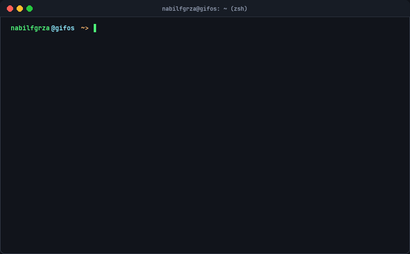

<div align="center">

  <!-- Ricer Terminal Header Badges -->
  <a href="#-about-me">
    
  </a>
  <a href="#-the-rice--environment">
    
  </a>
  <a href="#-connect--transmission">
    
  </a>
  <a href="#-the-rice--environment">
    
  </a>
  <a href="#-automated-terminal-engine">
    
  </a>

  <br /><br />

  <!-- PRIMARY ANIMATED RETRO TERMINAL (GIFOS VISUAL COMPONENT) -->
  <picture>
    <source media="(prefers-color-scheme: dark)" srcset="./assets/terminal.gif">
    <source media="(prefers-color-scheme: light)" srcset="./assets/terminal.gif">
    
  </picture>

  <br />
  <sub>
    ⚡ <i>Live-rendered retro console with 8-bit mascot pet, Neofetch system info, and real-time stats &bull; Inspired by <b>gifos</b></i>
  </sub>
  <br /><br />

  <!-- Terminal Quick Jump Pills -->
  <a href="#-system-motd--about-me"><code>[ 󰣇 System MOTD ]</code></a> &nbsp;
  <a href="#-the-rice--environment"><code>[ 󰄛 The Rice &amp; Dotfiles ]</code></a> &nbsp;
  <a href="#-tech-arsenal"><code>[  Tech Arsenal ]</code></a> &nbsp;
  <a href="#-github-telemetry"><code>[ 󰓅 GitHub Telemetry ]</code></a> &nbsp;
  <a href="#-automated-terminal-engine"><code>[ ⚙️ Workflow Engine ]</code></a> &nbsp;
  <a href="#-connect--transmission"><code>[ 󰮕 Transmission ]</code></a>

</div>

<br />

---

### 󰣇 System MOTD / About Me

```diff
+ [USER]      : nabilfgrza (Nabil Fajar)
+ [ROLE]      : Creative Frontend Engineer & Freelance Software Developer
+ [ACADÈMIE]  : Politeknik Negeri Malang (Polinema) - Informatics Engineering
+ [LOCATION]  : Malang, East Java, Indonesia (UTC+7)
+ [PASSION]   : Retro Linux Ricing, High-Performance Web Apps, Pixel Art & Terminal Aesthetics
- [PHILOSOPHY]: "Every keystroke matters. Modal editing is art. Dotfiles are personal identity."
! [CURRENTLY] : Architecting responsive web applications, refining Neovim Lua workflows & ricing CachyOS
```

---

### 󰄛 The Rice & Environment

```bash
nabilfgrza@gifos ~> inxi -Fz --neovim
```

| Component | Specification / Configuration | Details |
| :--- | :--- | :--- |
| **Operating Systems** | `CachyOS` (Arch Linux + BORE Kernel), `Parrot OS`, `Windows 11` | Tri-boot development workstation |
| **Window Manager** | `Hyprland` (Wayland) / `i3-gaps` (X11) | Smooth animations & tiled workspace workflows |
| **Primary Editors** | `Neovim` (Custom Lua config, Lazy.nvim, Treesitter, LSP) & `VSCode` | Fast modal editing with full IDE capabilities |
| **Terminal & Shell** | `Alacritty` / `Kitty` + `Zsh` (`zsh-autosuggestions`, `fzf`, `starship`) | Minimalist, ultra-responsive GPU-accelerated ricer setup |
| **Multiplexer** | `tmux` + custom tmux-sessionizer | Instant project context switching |
| **Color Palettes** | `Catppuccin Mocha`, `Dracula`, `Tokyo Night Storm` | Tailored contrast for long midnight coding sessions |

---

###  Tech Arsenal

```bash
nabilfgrza@gifos ~> tree -L 2 /usr/bin/stack
```

<div align="center">

#### Languages & Core Technologies
<p>
  
  
  
  
  
  
  
  
</p>

#### Frameworks, Libraries & Runtime
<p>
  
  
  
  
  
  
  
  
</p>

#### Developer Tooling & DevOps
<p>
  
  
  
  
  
  
  
  
</p>

</div>

---

### 󰓅 GitHub Telemetry

<div align="center">
  <table border="0">
    <tr>
      <td>
        
      </td>
      <td>
        
      </td>
    </tr>
  </table>

  <br />

  
</div>

---

### ⚙️ Automated Terminal Engine

This profile features a fully autonomous, self-updating retro terminal GIF inspired by `gifos` and Linux rice aesthetics.

```
┌─────────────────┐       ┌──────────────────────┐       ┌────────────────────────┐
│  GitHub Actions │ ────> │  scripts/generate_   │ ────> │ assets/terminal.gif    │
│  Cron Schedule  │       │  terminal.py         │       │ (Committed & Rendered) │
└─────────────────┘       └──────────────────────┘       └────────────────────────┘
```

#### Step-by-Step Local Reproduction:

1. **Clone the repository:**
   ```bash
   git clone https://github.com/Xskyis/Xskyis.git
   cd Xskyis
   ```

2. **Install dependencies (pure Python with Pillow):**
   ```bash
   pip install -r requirements.txt
   ```

3. **Render the animated retro GIF & preview:**
   ```bash
   python scripts/generate_terminal.py
   ```
   *The script will synthesize the 8-bit dark-grey cat mascot frames, render the terminal window frame, compile the typing and idle timeline, and export `assets/terminal.gif` (~140KB).*

4. **Automated Refresh via GitHub Actions:**
   The workflow [`.github/workflows/update-terminal.yml`](.github/workflows/update-terminal.yml) automatically executes daily at `00:00 UTC` (or on demand via `workflow_dispatch`), re-generating the animated GIF and updating your profile live without requiring manual maintenance!

---

### 󰮕 Connect / Transmission

```bash
nabilfgrza@gifos ~> ping -c 4 nabilfgrza.web.id
```

<div align="center">

  <a href="mailto:nabilfgrza@web.id">
    
  </a>
  &nbsp;
  <a href="https://linkedin.com/in/nabilfgrza" target="_blank">
    
  </a>
  &nbsp;
  <a href="https://github.com/Xskyis" target="_blank">
    
  </a>
  &nbsp;
  <a href="https://nabilfgrza.web.id" target="_blank">
    
  </a>

</div>

<br />

```bash
nabilfgrza@gifos ~> # Have a nice day kin_
[Process completed (code 0) - Session saved]
```
