  <picture>
    <source media="(prefers-color-scheme: dark)" srcset="./output.gif">
    <source media="(prefers-color-scheme: light)" srcset="./output.gif">
    
  </picture>

  <!-- Contribution Highlight Terminal Card -->
  <picture>
    <source media="(prefers-color-scheme: dark)" srcset="./assets/contributions.svg">
    <source media="(prefers-color-scheme: light)" srcset="./assets/contributions.svg">
    
  </picture>

